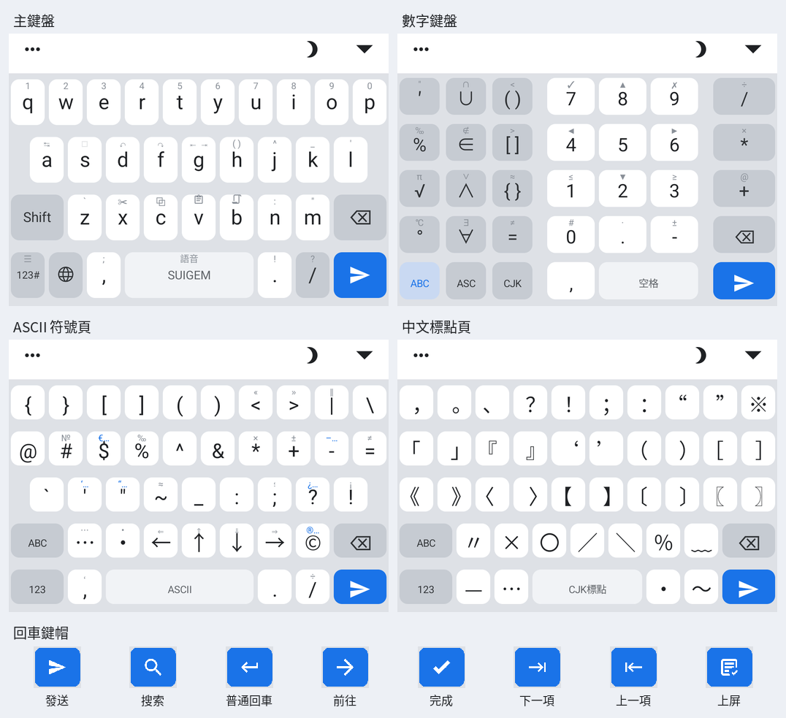
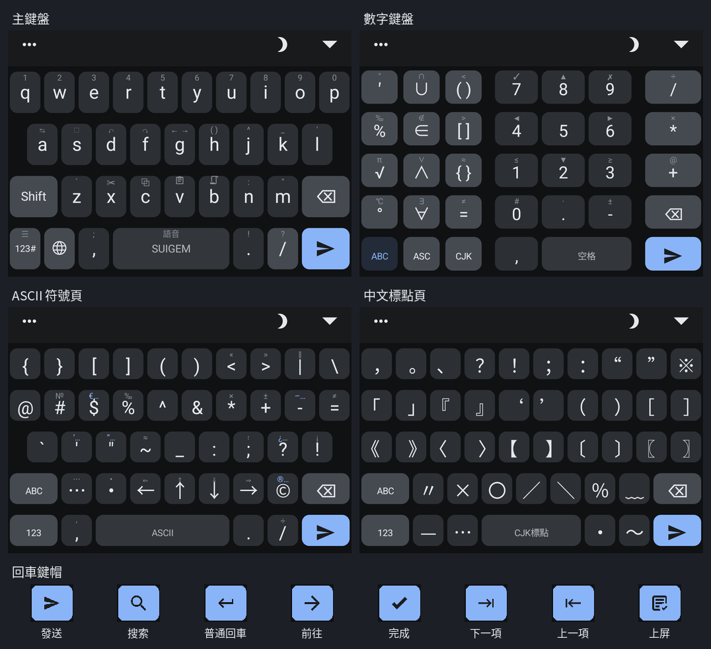

# 設計參考與定案

本目錄只用於視覺比較，不參與構建或部署。歷史方案可由 Git 找回；README 只記
仍有效的設計原則、定案和最終對照稿。

## 現行版本實拍

截自 Waydroid 上的 Trime 3.3.13／V1，畫面來源為 1080 × 2280。每組包含主鍵盤、
數字鍵盤、ASCII 符號頁、中文標點頁和八種回車鍵帽。

### 雲白



### 墨空



## 設計流程

版面、鍵位或配色改動先做**現狀／建議並排**的單檔互動 HTML，經確認後才改
`xuma_L.trime.yaml`。示意圖須遵守：

- 同屏比較原稿與修改稿，不能只給修改版；
- 短按與長按兩層都要呈現；
- 尺寸與顏色從主題讀取或按實機像素計算，不憑眼估；
- 1080p 為主稿，2K 按同一套 dp／sp 縮放；
- 定案後只把最終結果同步到 `KEYBOARD_MAP.md`。

優先用 `tools/render_keyboard.py` 讀主題生成畫面，避免示意圖與配置分叉：

```sh
uv run python tools/render_keyboard.py number --scheme xuma_night
uv run python tools/render_keyboard.py number --scheme xuma_cloud
```

Trime 顏色使用 `#AARRGGBB`，CSS 使用 `#RRGGBBAA`，八位色值不能直接照搬。

## 參考圖

| 檔案 | 用途 |
|---|---|
| `ref-gboard-拼音-light.jpg` | 小寫字母、功能鍵層級、地球鍵與留白 |
| `ref-trime風格-Shift文字藍Enter-light.jpg` | 文字 Shift、藍色 Enter、同文式功能鍵 |
| `ref-中英雙字鍵-大寫字母-light.jpg` | 中英狀態鍵和大寫字母方案的比較 |

主鍵盤預設使用小寫字母、文字 Shift 和實心藍色 Enter。地球鍵切換語言，
空格鍵隨語言顯示 `SUIGEM`／`English`。

## 數字小鍵盤定案

現行版採用左側三個等寬符號欄，中欄為集合與邏輯。配置與對齊見
[鍵位表](../KEYBOARD_MAP.md#四數字鍵盤頁number)；`numpad-aesthetic-review.html`
與 `numpad-waydroid-actual.png` 記錄上一代兩欄版。

## 其他定案

- `ABC` 返回鍵只顯示文字。數字頁使用淡染強調色，兩個符號頁與同頁 `123` 同色。
- ASCII 頁的全角長按配對及例外見 [鍵位表](../KEYBOARD_MAP.md)。
- 中文標點頁：按中文使用頻率排列，不為 Unicode 分類刻意留空。
- 剪貼板入口：長按 `v` 直接粘貼系統剪貼板，長按 `b` 打開剪貼板頁；外觀沿用主題色與圓角。
- Trime 主題無法控制剪貼板卡片的內聯操作、時間過期和空狀態文案，不在本倉仿製。

## 留存原則

最終 HTML 可保留作視覺回歸；純中間方案定案後可以刪除，Git 歷史就是歸檔。
不要把每輪試錯追加到本文件；可復用的技術原因寫入 `../LESSONS.md`。
